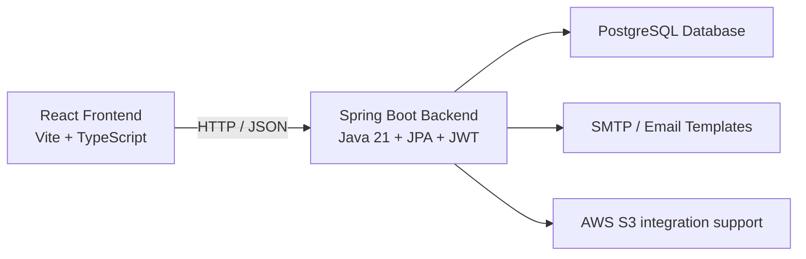

# Zar Finance

<div align="center">

[](https://www.java.com/)
[](https://spring.io/projects/spring-boot)
[](https://react.dev/)
[](https://www.typescriptlang.org/)
[](https://www.postgresql.org/)
[](https://jwt.io/)

</div>

A full-stack fintech and banking prototype built with a Spring Boot backend and a React frontend. Zar Finance models a modern digital banking experience with authentication, account management, transfers, password recovery, notifications, and an admin/auditor dashboard.

## Overview

Zar Finance is designed to demonstrate realistic product and engineering work across the stack:

- secure Java backend with JWT-based authentication
- role-aware access control for customer, admin, and auditor users
- financial workflows such as deposits, withdrawals, transfers, and balance updates
- email-driven communication and account lifecycle notifications
- audit and operational search capabilities
- frontend and backend integration for a cohesive banking experience

## Table of contents

- [Why this project matters](#why-this-project-matters)
- [Product overview](#product-overview)
- [Architecture](#architecture)
- [Technology stack](#technology-stack)
- [Repository structure](#repository-structure)
- [Roles and access model](#roles-and-access-model)
- [Key user journeys](#key-user-journeys)
- [Getting started](#getting-started)
- [Documentation](#documentation)
- [Project status](#project-status)

## Why this project matters

This project highlights several recruiter-relevant capabilities:

- secure Java backend development with Spring Security
- domain-driven banking logic and transactional rules
- full-stack integration between API and UI
- role-aware access control and operational tooling
- notification workflows using email templates
- realistic delivery of a fintech product prototype

## Product overview

Zar Finance allows users to:

- register for an account
- log in with email and password
- manage profile information and profile picture upload
- view account balances and metadata
- review transaction history
- transfer funds between accounts
- recover and reset a password through an email-based flow
- access admin or auditor views for operational lookup and monitoring

The app mirrors an end-to-end banking product workflow rather than a simple CRUD demo, making it suitable for backend, full-stack, and fintech-oriented portfolios.

## Architecture



## Technology stack

### Backend

- Java 21
- Spring Boot 4.0.8
- Spring Security
- Spring Data JPA
- PostgreSQL
- JWT via jjwt
- Thymeleaf email templates
- AWS SDK for S3
- OpenAPI / Swagger UI support

### Frontend

- React 19
- TypeScript
- Vite
- React Router
- Axios for API calls

## Repository structure

```text
zar-finance/
├── README.md
├── backend/
│   ├── Dockerfile
│   ├── compose.yml
│   ├── pom.xml
│   ├── mvnw
│   ├── README.md
│   └── src/
│       ├── main/
│       │   ├── java/
│       │   └── resources/
│       └── test/
├── frontend/
│   ├── README.md
│   ├── package.json
│   ├── vite.config.ts
│   ├── screenshots/
│   └── src/
└── .git/
```

## Roles and access model

The application includes a role-aware access model with role names such as:

- CUSTOMER
- ADMIN
- AUDITOR

The default registration flow assigns the CUSTOMER role when no role list is provided. Admin and auditor features are protected using method-level access checks.

## Key user journeys

### Customer journey

- register a new account
- receive an automated savings account
- sign in and receive a JWT token
- view profile, accounts, and transaction history
- transfer funds between accounts
- recover account access through the password-reset flow

### Operations journey

- review aggregate platform numbers
- search users by email
- inspect account details
- inspect transactions by account or transaction ID
- process customer deposits

## Getting started

### Prerequisites

- Java 21 or newer
- Maven
- Node.js and npm
- PostgreSQL instance
- SMTP-capable email configuration
- a local backend runtime environment with the required service variables configured

### Local startup

1. Start the backend:

```bash
cd backend
./mvnw spring-boot:run
```

2. Start the frontend:

```bash
cd frontend
npm install
npm run dev
```

3. Open the frontend in the browser at the local Vite URL, usually:

```text
http://localhost:5173
```

4. Ensure the backend is running on the configured API port, which the frontend targets through its API client.

## Documentation

- Backend documentation: [backend/README.md](backend/README.md)
- Frontend documentation: [frontend/README.md](frontend/README.md)

## Project status

This is a strong fintech prototype and portfolio application, not a production-grade banking system. It demonstrates real product logic, security patterns, and full-stack API integration while keeping local development assumptions and configuration values aligned with a development environment.

## Screenshot highlights

The frontend includes a screenshot gallery that captures the app’s live UI experience, including the login and transfer flows. These are documented in detail in the frontend README with valid relative references.

---

Zar Finance is built to show both engineering discipline and product awareness: secure backend design, user-centric flows, and operational tooling that fit a real digital banking product.
