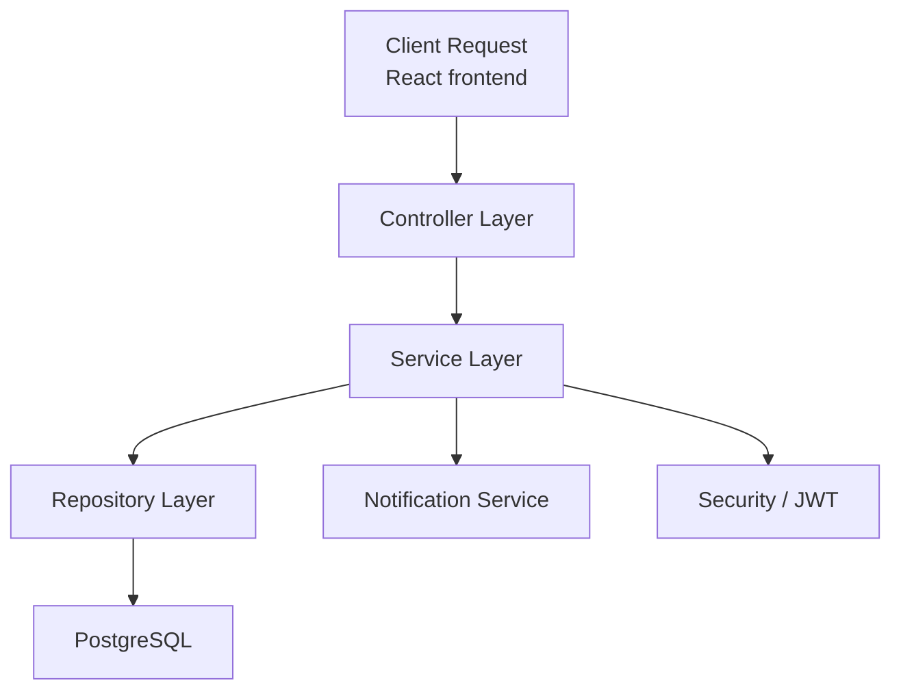

# Zar Finance Backend

<div align="center">

[](https://www.java.com/)
[](https://spring.io/projects/spring-boot)
[](https://www.postgresql.org/)
[](https://spring.io/projects/spring-security)
[](https://swagger.io/)

</div>

This README documents the backend of the Zar Finance banking application, built with Java, Spring Boot, Spring Security, and PostgreSQL. The backend exposes the core API for registration, authentication, accounts, transactions, password reset, notifications, and auditor/admin workflows.

## Overview

The backend is organized around a fintech domain model with the following main concerns:

- identity and access management
- account creation and ownership
- monetary transactions and validation
- email notifications and templated communication
- auditing and system-level lookups
- secure, token-based API authorization

## Table of contents

- [Architecture](#architecture)
- [Project structure](#project-structure)
- [Core domain model](#core-domain-model)
- [Security model](#security-model)
- [Application configuration](#application-configuration)
- [API reference](#api-reference)
- [Business workflow details](#business-workflow-details)
- [Database design](#database-design)
- [Mail and notification engine](#mail-and-notification-engine)
- [Build and run](#build-and-run)
- [Implementation caveats](#implementation-caveats)

## Architecture

The backend follows a layered structure:

- controllers: REST entry points
- services: business logic and orchestration
- repositories: JPA persistence access
- entities: domain model persisted to PostgreSQL
- DTOs: API contract objects
- security: JWT validation, method security, auth filters
- config: app beans, template resolver, AWS SDK client setup

### High-level flow



## Project structure

```text
backend/
├── Dockerfile
├── compose.yml
├── pom.xml
├── src/
│   ├── main/
│   │   ├── java/com/zar/zarfinance/
│   │   │   ├── account/
│   │   │   │   ├── controller/
│   │   │   │   ├── dtos/
│   │   │   │   ├── entity/
│   │   │   │   ├── repo/
│   │   │   │   └── services/
│   │   │   ├── audit_dashboard/
│   │   │   │   ├── controller/
│   │   │   │   └── service/
│   │   │   ├── auth_users/
│   │   │   │   ├── controller/
│   │   │   │   ├── dtos/
│   │   │   │   ├── entity/
│   │   │   │   ├── repo/
│   │   │   │   └── services/
│   │   │   ├── aws/
│   │   │   ├── config/
│   │   │   ├── enums/
│   │   │   ├── exceptions/
│   │   │   ├── notification/
│   │   │   ├── res/
│   │   │   ├── role/
│   │   │   ├── security/
│   │   │   ├── transaction/
│   │   │   └── ZarFinanceApplication.java
│   │   └── resources/
│   │       ├── application.properties
│   │       └── templates/
│   └── test/
└── target/
```

## Core domain model

### User

The User entity stores:

- first name and last name
- email (unique)
- phone number
- password hash
- active flag
- roles via a many-to-many relationship
- profile picture URL
- owned accounts
- created and updated timestamps

### Account

The Account entity stores:

- unique account number
- balance
- account type
- currency
- status
- owner user
- created and closed timestamps
- related transactions

### Transaction

The Transaction entity stores:

- amount
- transaction type
- date/time
- description
- status
- source account and destination account for transfers
- related account

### Role

The Role entity stores an authority name such as:

- CUSTOMER
- ADMIN
- AUDITOR

## Security model

The backend uses Spring Security with stateless JWT authentication.

### Authentication flow

1. The client sends email and password to `/api/auth/login`.
2. The backend checks the user record and verifies the password hash.
3. If valid, the server generates a JWT.
4. The token is returned to the client and must be attached in the `Authorization` header as a Bearer token.
5. `AuthFilter` validates the token on every secured request.

### Authorization rules

The security configuration permits public access to:

- `/api/auth/**`
- Swagger UI endpoints
- OpenAPI docs endpoints

All other requests require authentication.

Method-level rules are enforced with `@PreAuthorize`, including:

- admin-only user and role management
- admin or auditor access to dashboard endpoints

### Security components

- `SecurityFilter`: defines the filter chain and auth rules
- `AuthFilter`: extracts the bearer token and establishes authentication in the security context
- `TokenService`: creates and validates JWTs
- `CustomUserDetailsService`: loads user details for Spring Security
- `PasswordEncoder`: BCrypt-based password hashing

## Application configuration

The backend properties file uses environment-driven values for secrets and service credentials. The required keys visible in the project include:

```properties
server.port=${PORT}

spring.datasource.url=${LOCAL_DB_URL}
spring.datasource.username=${LOCAL_DB_USERNAME}
spring.datasource.password=${LOCAL_DB_PASSWORD}

jwt.secret.string=${JWT_SECRET}
jwt.expiration.time=${JWT_EXPIRATION_TIME}

spring.mail.username=${MAIL_USER}
spring.mail.password=${MAIL_PASS}

password.reset.link=http://localhost:3000/reset-password?code=

aws.accessKeyId=${AWS_ACCESS_KEY}
aws.secretAccessKey=${AWS_SECRETE_KEY}
aws.region=ap-southeast-2
aws.s3.bucketName=${AWS_BUCKET_NAME}
```

### Important notes

- the database connection is expected to be configured with a local PostgreSQL service
- the reset password link is prepared for local frontend routing
- mail credentials and AWS values are environment-driven and should be supplied by the runtime environment
- the project includes AWS S3 client wiring, but the active profile-picture flow in the current code uses a local upload path rather than the S3 uploader

## API reference

All API routes are under `/api`.

### Authentication

| Method | Endpoint | Access | Purpose |
| --- | --- | --- | --- |
| POST | `/api/auth/register` | Public | Create a new user account |
| POST | `/api/auth/login` | Public | Authenticate the user and return a JWT |
| POST | `/api/auth/forgot-password` | Public | Request a password reset code |
| POST | `/api/auth/reset-password` | Public | Reset the password using a reset code |

#### POST `/api/auth/register`

Creates a new user account.

Request body example:

```json
{
  "firstName": "Jane",
  "lastName": "Doe",
  "email": "jane@example.com",
  "phoneNumber": "+1234567890",
  "password": "StrongPassword123",
  "roles": ["CUSTOMER"]
}
```

Behavior:

- assigns the default CUSTOMER role when omitted
- creates a savings account automatically
- sends welcome and account-creation emails

#### POST `/api/auth/login`

Authenticates the user and returns a JWT token.

```json
{
  "email": "jane@example.com",
  "password": "StrongPassword123"
}
```

Returns:

```json
{
  "statusCode": 200,
  "message": "Login Successful",
  "data": {
    "token": "jwt-token",
    "roles": ["CUSTOMER"]
  }
}
```

#### POST `/api/auth/forgot-password`

Requests a password reset code.

```json
{
  "email": "jane@example.com"
}
```

Behavior:

- validates the user exists
- generates a reset code with a five-hour expiry
- emails a reset link to the user

#### POST `/api/auth/reset-password`

Resets the user password via a reset code.

```json
{
  "code": "RESET_CODE",
  "newPassword": "NewSecurePassword123"
}
```

### User management

| Method | Endpoint | Access | Purpose |
| --- | --- | --- | --- |
| GET | `/api/users` | Admin | List users with paging |
| GET | `/api/users/me` | Authenticated user | Return current profile |
| PUT | `/api/users/update-password` | Authenticated user | Update password |
| PUT | `/api/users/profile-picture` | Authenticated user | Upload a profile image |

#### GET `/api/users`

Admin only. Supports `page` and `size` query parameters with defaults of `0` and `50`.

#### GET `/api/users/me`

Returns the current logged-in profile and account metadata.

#### PUT `/api/users/update-password`

```json
{
  "oldPassword": "CurrentPassword123",
  "newPassword": "NewPassword456"
}
```

#### PUT `/api/users/profile-picture`

Multipart form field:

- `file`

Uploads an image and stores the relative file path used by the frontend.

### Accounts

| Method | Endpoint | Access | Purpose |
| --- | --- | --- | --- |
| GET | `/api/accounts/me` | Authenticated user | Retrieve user accounts |
| DELETE | `/api/accounts/close/{accountNumber}` | Authenticated user | Close an account if balance is zero |

### Transactions

| Method | Endpoint | Access | Purpose |
| --- | --- | --- | --- |
| POST | `/api/transactions` | Authenticated user | Create deposit, withdrawal, or transfer |
| GET | `/api/transactions/{accountNumber}` | Authenticated user | Retrieve transaction history |

#### POST `/api/transactions`

Supported transaction types include:

- DEPOSIT
- WITHDRAWAL
- TRANSFER

Example transfer payload:

```json
{
  "transactionType": "TRANSFER",
  "amount": 100.00,
  "accountNumber": "6681234567",
  "destinationAccountNumber": "6697654321",
  "description": "Rent payment"
}
```

Behavior:

- validates source balance for withdrawals and transfers
- updates balances for transfer source and destination
- saves the transaction
- sends email notifications to the sender and receiver when applicable

#### GET `/api/transactions/{accountNumber}`

Returns paginated transaction history for the authenticated account.

### Role management

| Method | Endpoint | Access | Purpose |
| --- | --- | --- | --- |
| POST | `/api/roles` | Admin | Create a role |
| PUT | `/api/roles` | Admin | Update a role |
| GET | `/api/roles` | Admin | List roles |
| DELETE | `/api/roles/{id}` | Admin | Delete a role |

### Auditor dashboard

| Method | Endpoint | Access | Purpose |
| --- | --- | --- | --- |
| GET | `/api/audit/totals` | Admin or auditor | Return platform totals |
| GET | `/api/audit/users?email={email}` | Admin or auditor | Find a user by email |
| GET | `/api/audit/accounts?accountNumber={accountNumber}` | Authenticated user in current code | View account details |
| GET | `/api/audit/transactions/by-account?accountNumber={accountNumber}` | Admin or auditor | Return transactions by account |
| GET | `/api/audit/transactions/by-id?id={id}` | Admin or auditor | Return a single transaction |

## Business workflow details

### Registration

The `AuthServiceImpl` flow does the following:

- resolves the default CUSTOMER role or validates requested roles
- checks for duplicate email addresses
- creates a new user record
- creates a savings account for the user
- sends welcome and account-creation emails

### Password reset

The reset flow uses a generated code stored in a dedicated entity and repository:

- create a unique reset code
- attach it to the user
- set expiry to five hours from creation
- send a reset link via email
- validate the code and expiry when the password is updated
- invalidate the reset code after successful use

### Transaction processing

The transaction service uses a switch on transaction type:

- DEPOSIT: increase the account balance
- WITHDRAWAL: subtract if funds are sufficient
- TRANSFER: reduce source balance and increase destination balance

All transaction flows record a successful status only after the core business validations pass.

### Auditing

The audit dashboard exposes summary and lookup data for operational oversight and internal review.

## Database design

The application uses JPA with PostgreSQL and a structured relational model:

- users table
- roles table
- users_roles join table
- accounts table
- transactions table
- notifications table
- password_reset_codes table

This design supports multi-role users, account ownership, and transactional history.

## Mail and notification engine

The notification layer uses `JavaMailSender` and Thymeleaf templates to send:

- welcome emails
- account creation alerts
- credit and debit notifications
- password reset and confirmation emails

Templates live under the backend resources/templates directory.

## Build and run

### Build

```bash
cd backend
./mvnw clean package
```

### Run locally

```bash
cd backend
./mvnw spring-boot:run
```

### Docker option

The repository includes a Dockerfile and a compose configuration for containerized deployment. The compose file targets a local app service and loads environment values from the project environment configuration.

## Implementation caveats

This is a strong prototype and learning project, and it is important to be accurate about its development posture:

- CORS is intentionally permissive for local development
- the project uses local development URLs for password reset and frontend routing
- the profile picture implementation currently saves to a developer-specific local folder rather than a portable production path
- the app is best treated as a local development prototype rather than a hardened production banking system

## Summary

The backend demonstrates a realistic, full-stack banking workflow with secure authentication, financial transaction logic, protected endpoints, and operational tooling. It is a strong example of domain-driven backend engineering and would fit well as a fintech or Java backend portfolio project.

